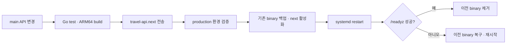

# Oracle VM API 자동 배포·복구 런북

현재 production API는 GitHub Actions가 OCI VM의 `/home/opc/travel-api`에 ARM64 바이너리를 배포합니다. `infra/oracle`의 `/opt/travel-api` 구성은 새 VM을 수동으로 초기화하거나 복구할 때 사용할 수 있는 별도 도구입니다.

## 1. 현재 자동 배포 경로



관련 파일:

- 워크플로: `.github/workflows/api-release-build.yml`
- VM 배포 로직: `scripts/deploy-api-on-vm.sh`
- production 서비스: `scripts/travel-api.service`
- 배포 회귀 테스트: `scripts/deploy-api-on-vm.test.sh`

## 2. GitHub Secrets

| 이름 | 역할 |
| --- | --- |
| `OCI_VM_IP` | VM 공인 IP 또는 호스트 |
| `OCI_VM_USER` | SSH 사용자, 현재 `opc` |
| `OCI_SSH_KEY` | 배포용 SSH 개인키 |
| `GOOGLE_MAPS_API_KEY` | 서버 Places 검색 키 |

키 값은 워크플로 YAML, 문서, 로그에 직접 쓰지 않습니다. SSH 공개키는 VM의 배포 사용자에게만 등록하고 개인키는 GitHub Actions Secret으로 관리합니다.

## 3. VM 디렉터리

```text
/home/opc/travel-api/
  .env
  travel-api
  travel-api.next
  travel-api.service
  deploy-api-on-vm.sh
```

- `.env`: `0600`
- 실행 바이너리와 배포 스크립트: `0750`
- systemd unit: `/etc/systemd/system/travel-api.service`

배포 중에만 `travel-api.rollback-<UTC timestamp>`와 실패 바이너리가 생길 수 있습니다. 정상 배포 뒤 롤백 바이너리는 제거됩니다.

## 4. production 환경변수

`/home/opc/travel-api/.env`에 아래 이름을 설정합니다.

```env
APP_ENV=production
PORT=8080
DATABASE_URL=<VM localhost PostgreSQL URL for travel_db>
JWT_SECRET=<32자 이상의 무작위 값>
ALLOWED_ORIGINS=https://kagoshima.hjh-dev.site
GOOGLE_MAPS_API_KEY=<Places API 서버 키>
```

메일 발송을 사용하는 production에서는 `RESEND_API_KEY` 또는 저장소의 `apps/api/.env.example`에 선언된 SMTP 환경변수를 설정합니다. 현재 운영은 Resend 경로를 사용합니다.

금지 사항:

- `AUTH_TEST_BYPASS`를 production에 설정하지 않습니다.
- `JWT_SECRET`에 `replace`, `change-me` 같은 placeholder를 사용하지 않습니다.
- `ALLOWED_ORIGINS`에 HTTP, 경로, 쿼리 또는 와일드카드를 넣지 않습니다.

환경 파일을 직접 보정할 때 같은 키가 중복되지 않게 기존 줄을 먼저 제거합니다.

```bash
sed -i '/^APP_ENV=/d' /home/opc/travel-api/.env
printf 'APP_ENV=production\n' >> /home/opc/travel-api/.env
chmod 600 /home/opc/travel-api/.env
```

## 5. 수동 상태 확인

```bash
sudo systemctl status travel-api --no-pager
curl --fail --silent http://127.0.0.1:8080/healthz
curl --fail --silent http://127.0.0.1:8080/readyz
curl --fail --silent https://api.hjh-dev.site/healthz
curl --fail --silent https://api.hjh-dev.site/readyz
sudo journalctl -u travel-api -n 100 --no-pager
```

`/healthz`는 API 프로세스가 응답하는지 확인하고, `/readyz`는 PostgreSQL까지 요청을 처리할 준비가 되었는지 확인합니다. 배포 승격과 롤백 판단에는 `/readyz`를 사용합니다.

환경 파일 값 자체를 출력하는 명령은 화면 공유나 CI 로그에서 실행하지 않습니다.

## 6. 실패 원인별 대응

### production 환경 검증 실패

`scripts/deploy-api-on-vm.sh`가 새 바이너리를 바꾸기 전에 중단합니다. `.env`의 필수 키, JWT 길이, `AUTH_TEST_BYPASS`, Origin 형식을 확인한 뒤 workflow를 다시 실행합니다.

### `Text file busy`

실행 중인 바이너리에 덮어쓰지 않습니다. 워크플로는 항상 `travel-api.next`로 전송하고, 기존 활성 바이너리를 timestamp가 붙은 롤백 파일로 `mv`한 뒤 next를 활성화합니다. 예전 방식의 `travel-api.old`가 남아 있으면 첫 롤백 후보로 흡수합니다.

### systemd 시작 실패

```bash
sudo systemctl daemon-reload
sudo systemctl restart travel-api
sudo journalctl -u travel-api -n 150 --no-pager
```

서비스 unit의 `WorkingDirectory`, `ExecStart`, `EnvironmentFile`이 모두 `/home/opc/travel-api`를 가리키는지 확인합니다.

### readiness check 실패

배포 스크립트가 이전 바이너리를 복구합니다. 복구도 실패했다면 다음 순서로 확인합니다.

1. `systemctl status`와 `journalctl`
2. `.env` 권한과 필수 환경변수 이름
3. VM 로컬 PostgreSQL 연결과 DB 상태
4. 8080 포트 점유
5. Caddy upstream과 인증서

실패한 새 바이너리는 `travel-api.failed-<timestamp>`로 남을 수 있으므로 원인 분석 뒤 명시적인 파일만 제거합니다.

## 7. 수동 재배포

GitHub Actions를 사용할 수 없을 때 로컬에서 ARM64 바이너리를 빌드해 `travel-api.next`로 전송한 후 동일 스크립트를 실행합니다.

```bash
cd apps/api
CGO_ENABLED=0 GOOS=linux GOARCH=arm64 go build -trimpath -ldflags="-s -w" -o /tmp/travel-api.next ./cmd/api
scp -i <SSH_KEY> /tmp/travel-api.next opc@<OCI_VM_IP>:/home/opc/travel-api/travel-api.next
ssh -i <SSH_KEY> opc@<OCI_VM_IP> '/home/opc/travel-api/deploy-api-on-vm.sh /home/opc/travel-api'
```

실제 키 경로나 IP를 문서 또는 셸 기록에 고정하지 않습니다.

## 8. 새 VM 복구

새 VM을 처음 구성할 때는 [`../infra/oracle/README.md`](../infra/oracle/README.md)의 수동 초기화 도구를 사용할 수 있습니다. 다만 자동 배포 표준 경로와 실행 사용자가 다르므로, production 복구에서는 다음 중 하나를 선택해 끝까지 통일합니다.

- 현재 표준: `opc`, `/home/opc/travel-api`, `scripts/travel-api.service`
- 수동 강화 구성: `travel-api` 시스템 사용자, `/opt/travel-api`, `infra/oracle/systemd/travel-api.service`

두 unit과 두 배포 스크립트를 한 서비스에 섞지 않습니다.

## 9. 배포 전후 체크리스트

### 배포 전

- API 테스트와 `scripts/deploy-api-on-vm.test.sh` 통과
- 스키마 변경의 기존 데이터 호환성 확인
- GitHub Secrets 이름과 VM SSH 접근 확인
- `.env`의 production 가드 확인

### 배포 후

- 내부·외부 `/healthz`, `/readyz` 확인
- 로그인 세션 복구 확인
- 변경된 대표 API 흐름 확인
- 새 migration 적용 오류가 없는지 로그 확인
- 롤백 임시 파일이 정상 정리됐는지 확인

## 10. 운영 DB 백업과 복원

운영 PostgreSQL의 `travel_db`는 VM 로컬에 있습니다. `/var/backups/travel-api`의 로컬 덤프만으로는 VM 손실에 대응할 수 없으므로, `travel-api-backup.timer`가 매일 03:00~03:15 KST(18:00~18:15 UTC)에 custom-format 덤프를 생성하고 OCI Object Storage의 비공개 `travel-api-backups/db/` 경로로 업로드합니다. 로컬 파일은 최소 14일, 버킷 객체는 수명 주기 정책으로 30일 보관합니다. VM의 instance principal은 이 버킷 경로에 새 객체를 생성할 수 있을 뿐 기존 객체를 읽거나 덮어쓰거나 삭제할 수 없습니다.

새 VM에서는 OCI CLI와 PostgreSQL client를 설치하고, VM 인스턴스 ID만 포함하는 dynamic group 및 위 버킷 `db/*`의 `OBJECT_CREATE`만 허용하는 IAM 정책을 먼저 적용합니다. `sudo install -d -o postgres -g postgres -m 700 /var/backups/travel-api`로 백업 디렉터리를 먼저 생성합니다. 그런 다음 `infra/oracle/scripts/backup-postgres.sh`를 `/usr/local/libexec/travel-api-backup.sh`로, `infra/oracle/systemd/travel-api-backup.{service,timer}`를 `/etc/systemd/system/`에 설치하고 `systemctl daemon-reload`, `systemctl enable --now travel-api-backup.timer`를 실행합니다. 실제 업로드가 성공하기 전에는 자동 배포를 다시 켜지 않습니다.

```bash
sudo systemctl list-timers travel-api-backup.timer --no-pager
sudo systemctl start travel-api-backup.service
sudo systemctl show travel-api-backup.service -p Result -p ExecMainStatus
sudo journalctl -u travel-api-backup.service -n 50 --no-pager
```

배포 스크립트는 새 바이너리로 교체하기 전에 동일한 백업 서비스를 실행하고, 백업 실패 시 배포를 중단합니다. DB 마이그레이션은 아직 API 시작 시 실행됩니다. **바이너리 롤백은 DB 스키마를 되돌리지 않으므로**, 스키마 변경은 이전·새 바이너리 모두에서 동작하는 추가형 변경으로 배포하고, 호환되지 않는 변경은 별도 변경 절차와 복원 계획을 세워야 합니다.

OCI 계정 관리 권한이 있는 환경에서 `oci os object list --bucket-name travel-api-backups --prefix db/`로 원격 객체를 확인합니다. VM의 최소 권한 계정에서는 목록 조회가 의도적으로 거부됩니다. 실제 복원은 원본 `travel_db`에 바로 적용하지 말고 격리된 DB에 `pg_restore --single-transaction --no-owner`로 수행한 뒤 테이블·행 수와 대표 조회를 비교합니다. 2026-10-30에는 원격 객체를 격리 DB에 복원해 사용자·여행·장소·일정·항공편·체크리스트 건수가 원본과 일치함을 확인했습니다. 이 시험만으로 장래의 복구 시간이나 무손실 복구를 보장하지는 않습니다.

`pg_dump`에는 PostgreSQL 클러스터의 역할과 VM의 `.env` 비밀값이 포함되지 않습니다. 새 VM 복구 시 DB 계정 및 서비스 비밀값은 별도 보관된 운영 기록에서 재구성해야 합니다. 이 별도 보관 상태는 이번 백업 검증 범위에 포함되지 않았습니다.

`.github/workflows/production-health.yml`은 공개 웹·API를 15분마다 확인하고, 매일 04:30 KST에 백업 타이머 상태 및 해당 백업 창(03:00 KST) 이후 생성된 덤프를 확인합니다. 수동 실행은 아직 점검 마감이 지나지 않았다면 직전 백업 창을 기준으로 합니다. 이 기준으로 어제 덤프가 오늘 백업 누락을 가리지 못하게 합니다. 업로드 실패 시 백업 서비스가 실패하므로 후자의 검사도 실패합니다. GitHub Actions의 예약 실행은 지연될 수 있고 워크플로 실패가 자동 호출·문자 알림을 보장하지 않으므로, 저장소의 Actions 실패 알림을 받을 담당자와 대체 연락 경로를 별도로 정해야 합니다.

## 11. 로그 보존

공유 링크는 URL 경로에 접근 토큰을 담으므로, API의 요청 로그와 오류 알림이 `/api/share/{token}` 형태로 마스킹된 버전을 **먼저 배포**합니다. 그 후 `infra/oracle/systemd/journald-travel-api.conf`를 VM의 `/etc/systemd/journald.conf.d/50-travel-api.conf`로 설치하고 journald를 재시작·flush해 영구 로그를 활성화합니다. 설정은 최대 256 MiB 또는 14일 중 먼저 도달하는 범위로 로그를 제한합니다. 기존 휘발성 로그에는 마스킹 전 URL이 남아 있을 수 있으므로 접근 권한을 제한하고 불필요하게 외부로 복사하지 않습니다. 로그의 VM 외부 보관은 별도 과제입니다.
